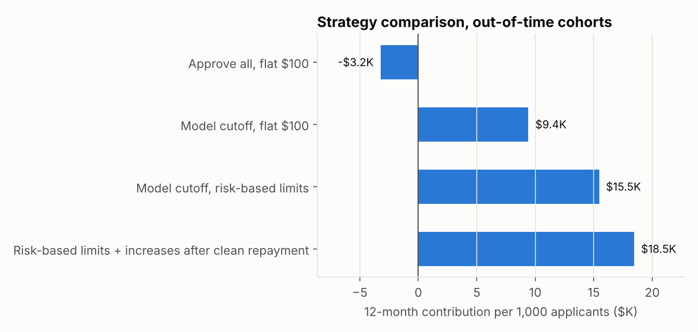
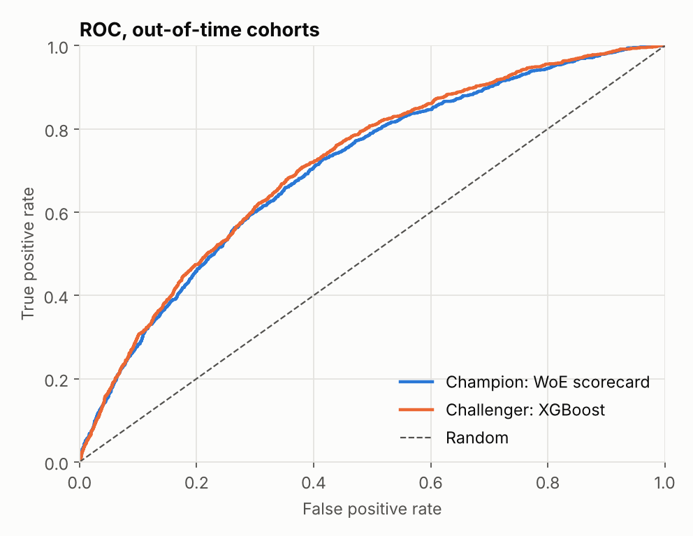
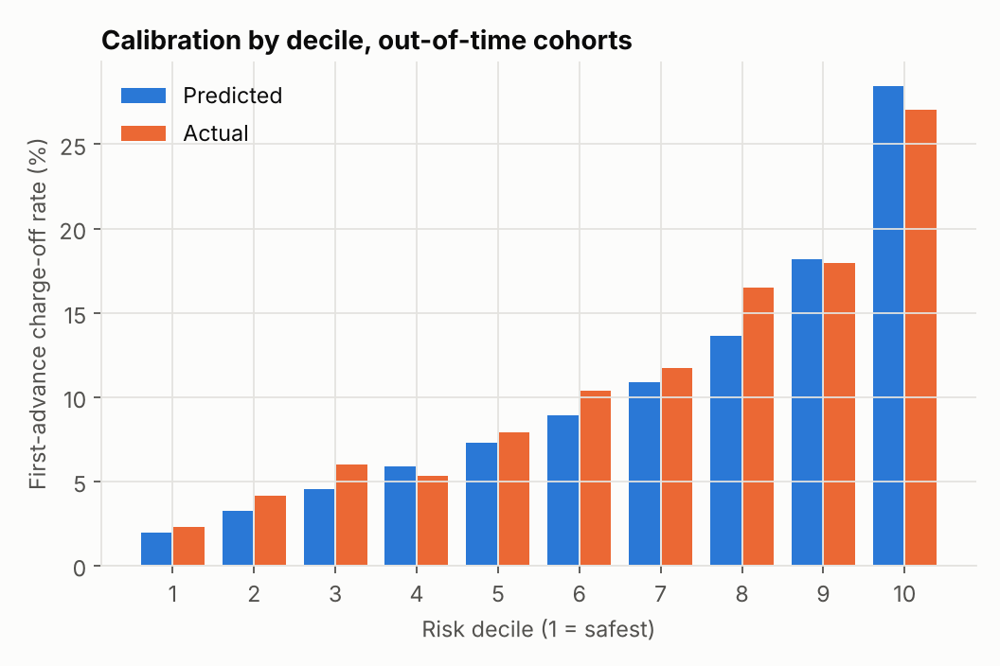
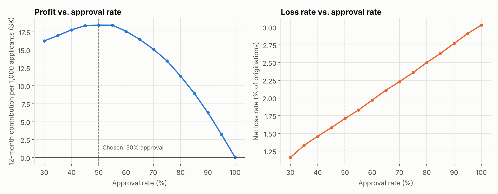
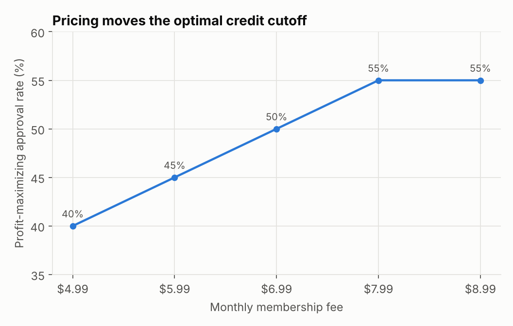
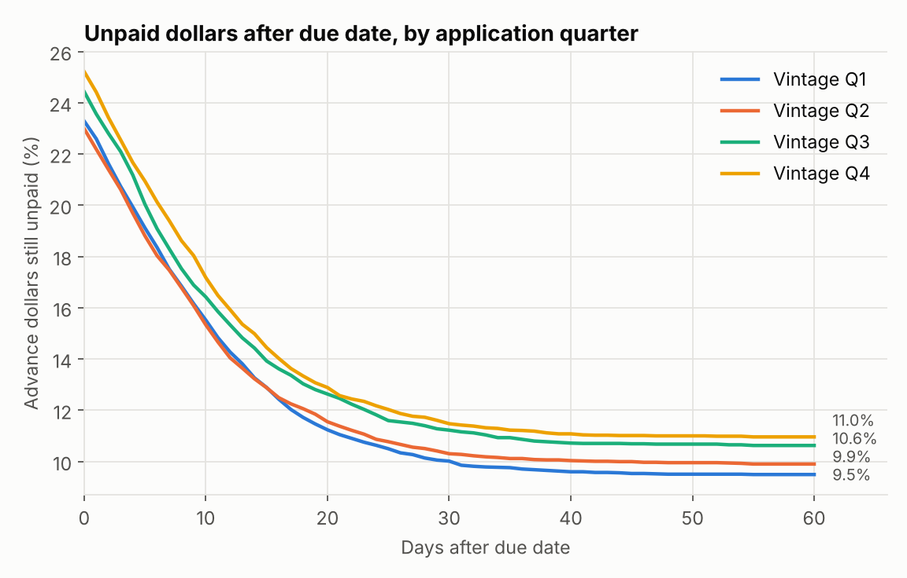
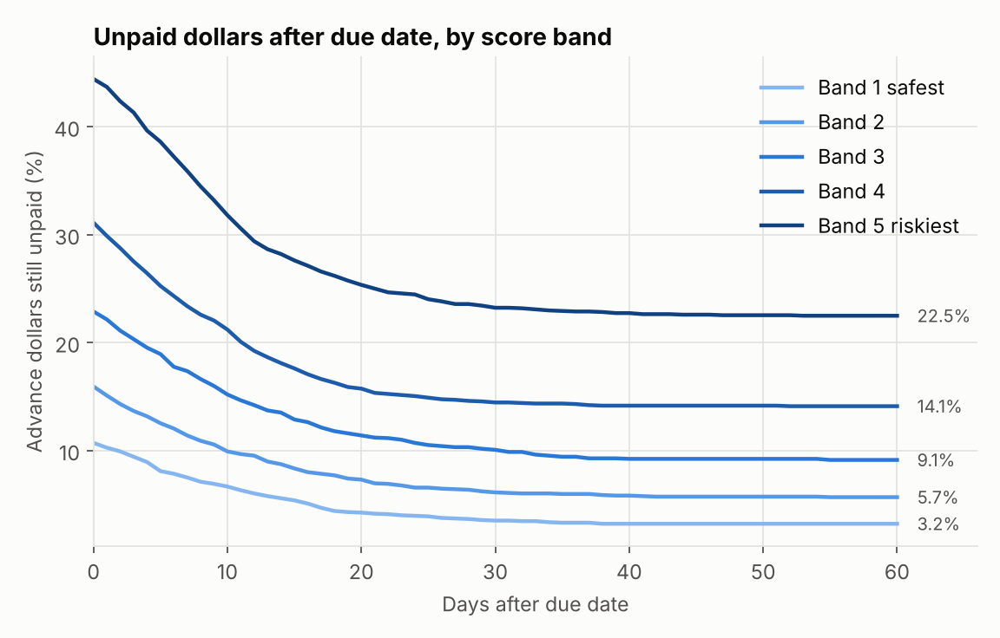

# Cash Advance Underwriting

**Cash-flow credit decisioning, risk-based limits and unit economics for a direct-to-consumer cash advance / earned-wage-access (EWA) product.**

This project shows how a lender's credit team would build a first-advance decision from linked bank data. It goes past model accuracy to the business call: where to set the cutoff, how much to lend, and what it does to losses and profit.

> **Data note:** no public loan-level data exists for cash advance products, so all applicant, bank and repayment data is **simulated** from stated assumptions (see [`docs/assumptions.md`](docs/assumptions.md) and [`src/cashadvance/config.py`](src/cashadvance/config.py)). Every number below comes from that simulation and is fully reproducible. The methods carry over directly to real bank-transaction data.

---

## Results at a glance

On held-out, out-of-time cohorts (applications from months 9–12):

| | Approve everyone at $100 | Recommended policy |
|---|---|---|
| Approval rate | 100% | 50% |
| First-advance charge-off rate | 10.4% | 4.6% |
| Net loss rate, % of dollars advanced | 4.0% | 1.7% |
| 12-month contribution per approved member | –$3.23 | $36.91 |
| 12-month contribution per 1,000 applicants | **–$3.2K** | **+$18.5K** |
| Payback on acquisition cost | never | month 5 |

**Recommended policy:** WoE scorecard, cutoff score 558 (about 50% approval); starting limits of $25–$250 by risk band; +$25 after each on-time repayment, up to $500.



**What drives the gain:**
1. **Declining the riskiest half:** goes from losing $3.2K per 1,000 applicants to earning $9.4K.
2. **Sizing limits to risk instead of a flat $100:** raises it to $15.5K.
3. **Raising limits after clean repayments:** takes it to $18.5K. Growth comes from members who have already proven they repay.

## Model performance

| Model | Validation AUC | Out-of-time AUC | Out-of-time KS | Out-of-time Gini | PSI (dev vs. OOT) |
|---|---|---|---|---|---|
| **Champion:** WoE logistic scorecard | 0.716 | 0.705 | 0.31 | 0.41 | 0.004 |
| **Challenger:** monotonic XGBoost | 0.727 | 0.715 | 0.33 | 0.43 | 0.005 |

The challenger adds about 1 point of AUC, worth about $1.4K per 1,000 applicants at the same approval rate. The recommendation is to **launch the scorecard**, which is explainable and produces clean adverse-action reasons, and run XGBoost in a randomized challenger cell until the lift is proven in production. The challenger's train AUC of 0.77 against 0.72 on validation is the overfitting a challenger cell would catch.

| ROC | Calibration |
|---|---|
|  |  |

## What the project covers

- **Cash-flow features from raw bank data.** Income detection from deposits, pay-period regularity, balance-to-income ratios, days overdrawn, overdraft events and balance trend ([`features.py`](src/cashadvance/features.py)). These are the signals thin-file underwriting runs on.
- **Champion/challenger modeling.**
  - A Weight-of-Evidence scorecard with Information Value, points scaling (600 points at 50:1 odds, 20 points to double the odds) and an out-of-time test.
  - A monotonic-constrained XGBoost challenger ([`models.py`](src/cashadvance/models.py)).
- **Adverse action reason codes.** Each decline maps to plain-language principal reasons, ranked by points lost against the best bin, as ECOA and Regulation B adverse action notices require. Example: [`sample_adverse_action_reasons.csv`](reports/sample_adverse_action_reasons.csv).
- **Profit-maximizing cutoff.** A 12-month member P&L at each approval rate: membership and instant-transfer fees, funding cost, processing, servicing, charge-offs net of recovery, and acquisition cost ([`strategy.py`](src/cashadvance/strategy.py)).
- **Risk-based limits and step-ups.** Starting limits by risk band, then increases earned through on-time repayment.
- **Loss curves.** Unpaid dollars by days past due, by application vintage and by score band.
- **Pricing × credit interaction.** The profit-maximizing approval rate moves from 40% at a $4.99 fee to 55% at $7.99. Pricing and credit policy have to be set together.

| Profit vs. approval rate | Pricing sensitivity |
|---|---|
|  |  |

| Loss curves by vintage | Loss curves by score band |
|---|---|
|  |  |

## Credit committee memo

[`reports/credit_committee_memo.md`](reports/credit_committee_memo.md) is the recommendation written for a credit committee: the policy, expected performance, the challenger plan, monitoring triggers, regulatory considerations and limitations.

## Run it

```bash
pip install -r requirements.txt
python run_pipeline.py          # simulate -> features -> models -> strategy -> reports (about 15 seconds)
pytest -q                       # unit tests
python notebooks/build_notebook.py   # rebuild the walkthrough notebook
```

All assumptions live in [`src/cashadvance/config.py`](src/cashadvance/config.py). Change one, such as the membership fee, funding cost or acquisition cost, and re-run to see the policy move.

## Repository layout

```
src/cashadvance/
  config.py      every simulation and business assumption
  simulate.py    applicants, 90 days of deposits and balances, first-advance outcomes
  features.py    cash-flow underwriting features
  models.py      WoE scorecard, XGBoost challenger, metrics, reason codes
  strategy.py    cutoffs, limit policies, 12-month member P&L, loss curves
  reporting.py   charts
run_pipeline.py  end-to-end run
notebooks/       executed walkthrough notebook
reports/         memo, results.json, CSV outputs, figures
docs/            assumptions
tests/           unit tests
```

## About

Built by **Hiren Patel**: consumer lending executive (Capital One card, loans and auto; Walmart/Sam's Club financial services; co-founder and Chief Credit Officer at two FinTech lenders). [LinkedIn](https://www.linkedin.com/in/hdpatel)
